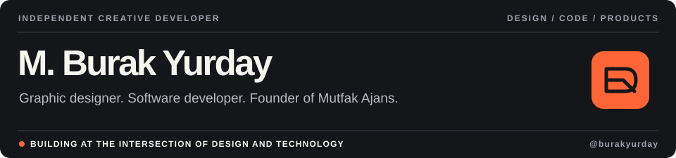
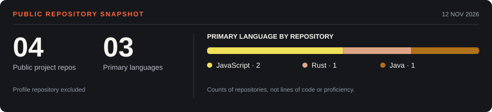

  

  
  

### Design with intention. Build with purpose.

I'm a creative developer and graphic designer working at the intersection of visual identity, interfaces and software. I run **Mutfak Ajans**, where I build digital products and tools for real creative workflows.

## Selected projects

| [Mutfak Sync ↗](https://github.com/burakyurday/mutfak-drive-yedekleme) | [SOS Bark ↗](https://github.com/burakyurday/sos-bark) |
| :--- | :--- |
| Cross-platform desktop backup for creative teams. One-way Google Drive synchronization with folder preservation. | Android-to-iPhone SOS notification prototype using Bark. |
| `Rust` `Tauri` `React` `TypeScript` | `Java` `Android` `Gradle` |
| **Development preview** | **Experimental prototype** |

## Stack & tools

## GitHub activity

  

Public GitHub data · [Metrics workflow](https://github.com/burakyurday/burakyurday/actions/workflows/metrics.yml) · [lowlighter/metrics](https://github.com/lowlighter/metrics)

## Focus

**Creative development** — Web platforms, desktop apps and automation.  
**Design** — Brand identity, graphic design and UI systems.  
**Exploration** — AI-assisted development and practical new product ideas.

---

DESIGN / DEVELOPMENT / INDEPENDENT CREATIVE WORK

<!-- Profile inspiration: https://github.com/abhisheknaiidu/awesome-github-profile-readme -->
