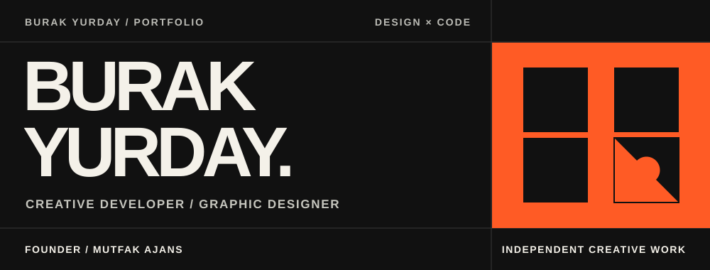
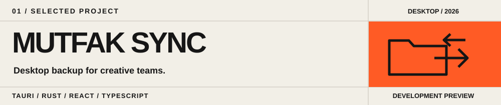
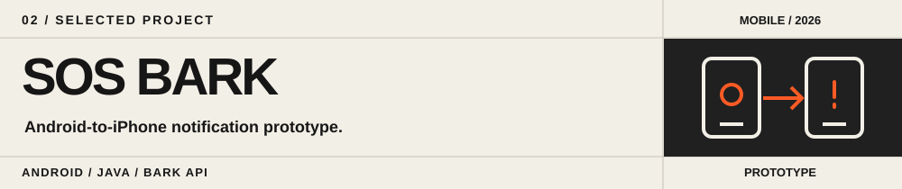

### Design that works. Software that feels considered.

I am a creative developer and graphic designer building digital products at the intersection of brand identity, interface design and software. As the founder of **Mutfak Ajans**, I turn creative workflows into practical tools and digital experiences.

`BRAND & UI DESIGN`  `WEB DEVELOPMENT`  `DESKTOP APPS`  `AUTOMATION`

## 01 — Selected work

A one-way Google Drive backup application for macOS and Windows. Preserves folder hierarchies and keeps local deletions separate from cloud copies. Currently a development preview.

[View project →](https://github.com/burakyurday/mutfak-drive-yedekleme)

A lightweight Android prototype for sending SOS notification requests to an iPhone through Bark. Experimental, not a replacement for emergency services.

[View project →](https://github.com/burakyurday/sos-bark)

## 02 — My practice

| | |
| :--- | :--- |
| **DESIGN** | Brand identity, editorial typography, UI design and visual systems |
| **DEVELOPMENT** | Web platforms, desktop applications and workflow automation |
| **EXPLORATION** | AI-assisted creative production and new digital product ideas |

**Design tools** · Figma · Photoshop · Illustrator  
**Development stack** · TypeScript · React · Next.js · Tailwind CSS · Rust · Tauri · Java · SQLite · Prisma

---

**M. Burak Yurday / Independent creative work**  
[Explore all repositories ↗](https://github.com/burakyurday?tab=repositories)
